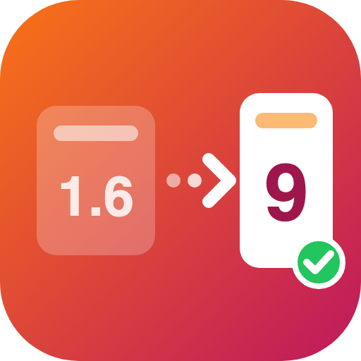

# Shop Migrator - Upgrade to PrestaShop 9 by Data Transfer

Move your shop from PrestaShop 1.6, 1.7, 8 or 9 to a new PrestaShop 9 store: products, customers, orders and everything around them. The old shop is only read, never changed.

Free and open source (AFL-3.0). Two modules work together:

| Module | Install on | Download |
|---|---|---|
| **Shop Migrator** (this repository) | the new PrestaShop 9 shop | `shopmigrator-x.y.z.zip` |
| **[Shop Migrator Bridge](https://github.com/iamshoaibktk/prestashop-shopmigratorbridge)** | the old shop (1.6, 1.7, 8, 9) | `shopmigratorbridge-x.y.z.zip` |

Both zips are attached to every release.

## What it migrates
- **Catalog:** taxes and tax rules, brands, suppliers, categories, attributes and features, products with combinations, prices, specific prices, stock, packs, tags, customization fields and images (thumbnails rebuilt in every format: jpg, webp, avif)
- **Shipping:** carriers with zones, price and weight ranges
- **Customers:** addresses, groups, carts, and their **old passwords** (PrestaShop 1.6 MD5 hashes are recognised at first login and upgraded to bcrypt)
- **Orders:** details, history, carriers, invoices, payments, credit slips, returns, messages (1.6 order notes become customer threads)
- **Marketing and content:** cart rules (vouchers), catalog price rules, CMS pages and categories, customer service contacts
- **Employees:** added only when their ID and email are free, so your own account is never touched

IDs are kept, so order references, links and URLs stay the same.

## How it works
1. Install **Shop Migrator Bridge** on the old shop and copy its address and 64-character key.
2. Install **Shop Migrator** on the new shop, paste them and click **Test connection**.
3. Choose what to migrate, the speed and the mode, then **Start migration**.
4. Read the report (with warnings) and download it.

**Fresh copy** replaces the selected data on the new shop. **New data only** adds what was created on the old shop since the last run and keeps everything you changed on the new one: keep selling on the old shop and sync the last orders on switch day.

## Built for big shops
- Runs in short steps (about 6 seconds per request) and saves its position after every batch: **pause, resume or close the tab** at any time; network errors are retried
- **Keyset paging** on primary keys (tables without one are paged on an index), so row 5,000,000 is as fast as row 1
- **Adaptive batch size** (10 to 5,000 rows per request), one multi-row upsert per batch, keep-alive connection, gzip
- Search index, catalog price rules and message conversion are rebuilt in **resumable chunks**
- Optional: skip thumbnails during the run and regenerate them later

Benchmark on a local test machine, PrestaShop 1.7.8 to 9:

| Run | Rows | Time | Peak memory |
|---|---|---|---|
| Fresh copy (300k customers and addresses, 300k orders, 100k products) | 2.6 million | 6 min 16 s | 115 MB |
| New data only, 5,000 new customers, products and orders | 60,000 | 24 s | |
| New data only, nothing new | 0 | 7 s | |

## Old URLs keep working
After a migration, links in older URL formats (`/women/5-faded-short.html`, `/3_brand`, `/2__supplier`, `/old-path/3-clothes`) get a **301** to the same product, category, CMS page, brand or supplier on the new shop.

## Requirements
- New shop: PrestaShop 9.0+, PHP 8.1+, with the old shop's languages and currencies installed
- Old shop: PrestaShop 1.6, 1.7, 8 or 9, PHP 5.6+, reachable from the new shop

## Languages and docs
English, French, Spanish, Italian, Polish, German, Czech, Dutch, Portuguese, Russian. PDF user guide in all 10 languages in [`docs/`](docs/).

## Author and support
- Email: iamshoaibktk@gmail.com
- WhatsApp: +923459016286
- Fiverr: https://www.fiverr.com/shoaibktk

## License
[Academic Free License 3.0 (AFL-3.0)](https://opensource.org/licenses/AFL-3.0)
